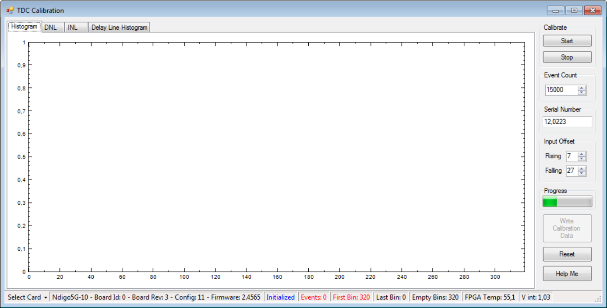

===================
Calibrating the TDC
===================

After each update of the Ndigo5G-10 firmware the TDC has to be
calibrated.

The calibration is done with the tool ``TDCCalibration.exe``
which is available after installing the Ndigo device driver.

After invoking the application a window as shown in Figure
:numref:`fig calib`.

    Screenshot of ``TDCCalibration.exe``.

The calibration procedure is as follows:

#. Connect an external pulse signal to the Trigger input. The signal
   should be low active with a frequency in the kHz range. It must not
   be synchronized to the clock source of the Ndigo5G-10. The input
   frequency must not exceed 10 MHz. The pulse low and high width has to
   be at least 10ns each.
#. Set *Serial Number* according to the sticker on the card if the shown
   value is not correct.
#. Start capturing pulse events by pressing the *Start* button.
#. Adjust the *Input Offset* so that *First Bin* is in the range of 4 to
   16\ . If *First Bin* is less than 4, increment *Input Offset* by one.
   If *First Bin* is greater than 16, decrement *Input Offset* by one.
   Repeat increment/decrement until *First Bin* is in the range of 4 to
   16\ . Depending on the firmware revision the *Input Offset* value for a
   successful calibration may be in the range of 6–10 or 28–32.
#. When the *Write Calibration Data* button becomes enabled press it to
   update the calibration data on the card.
#. Calibration done!

The card can only be successfully calibrated if:

-  *First Bin* is in the range of 4 to 16
-  *Empty Bins* is less than (First Bin + 4)
-  at least 10,000 events have been captured
-  a valid serial number is set.

.. hint::

    If the application reports an error, check if the input pulse is within
    specification.