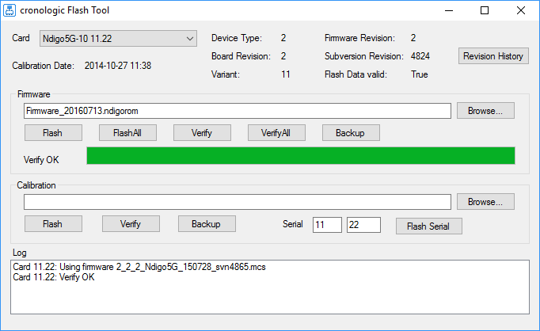

===============
Firmware Update
===============

After installing the Ndigo device driver, a firmware update tool is
available, which is performed by choosing ``NdigoFirmwareGUI.exe``.

After invoking the application a window as shown in
:numref:`fig firmware` will appear.

    Screenshot of ``NdigoFirmwareGUI.exe``.

The tool can be used for updating the firmware and to create a backup of the
on-board calibration data of a particular Ndigo5G unit.
If several boards are present, the one which is
going to be used can be selected in the upper left corner of the window.

Pressing the “Backup” buttons a backup of the firmware or the
calibration data will be created, respectively.

In order to perform a firmware update, chose appropriate “.ndigorom”-file 
by pressing “Browse”. The file contains the firmware PROMs for all boards
of the Ndigo5G product line.

By pressing “Flash” the firmware is written to the board.

“Verify” can be used to compare the data stored inside the PROM
to the one inside a file.

.. attention::

    The new firmware will only be used after a power
    cycle, i.e. after switching the PC (or Ndigo crate) off and back on.

    *A simple reboot is not sufficient.*

    Therefore, the information shown in the upper half of the application
    window does not change right after flashing a new firmware.

After flashing and shutting the PC or the crate off and on again it is
recommended to perform a window calibration.
The tool “WindowCalibration” is provided for that purpose within the driver
installation.

The omission of the calibration process leads to longer
execution times of applications using that firmware, since the
calibration is performed then instead.
